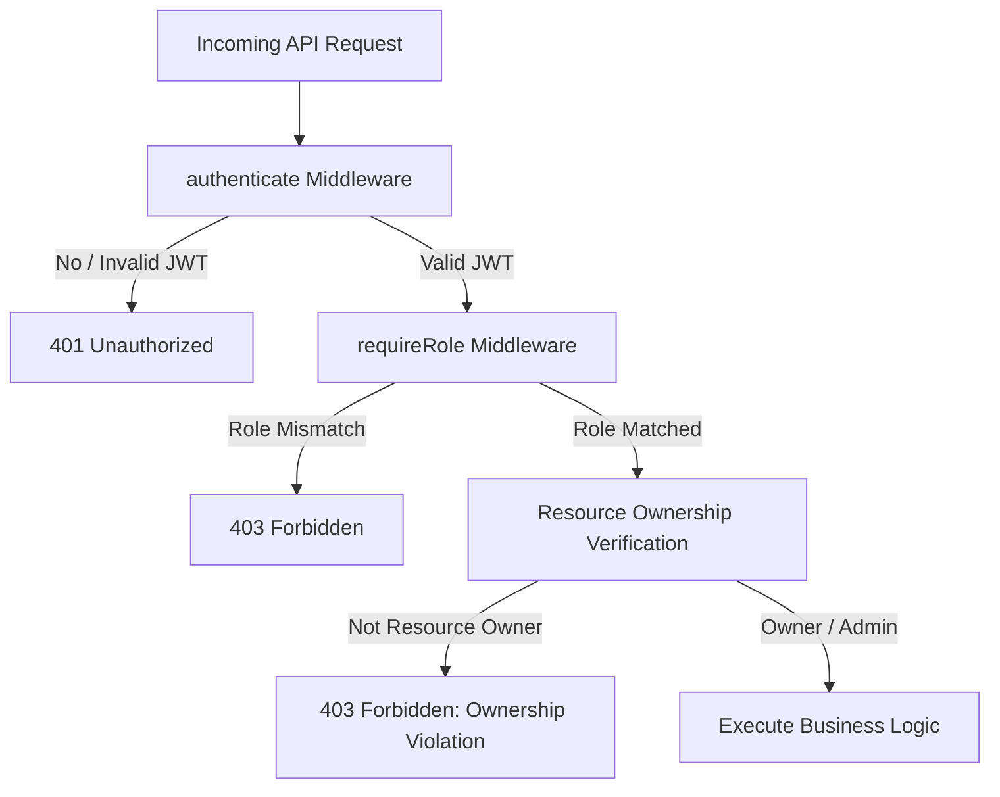

# System Architecture Document

## 1. Overview
The **Multi-Vendor E-Commerce Marketplace** is designed as a high-performance **modular monolith** with a separated React frontend and Express backend. It provides distinct experiences for three primary actors: **Customers**, **Vendors**, and **Marketplace Admins**.

---

## 2. Architecture Diagram

```
+---------------------------------------------------------------------------------+
|                                 CLIENT LAYER                                    |
|  +------------------------+  +------------------------+  +-------------------+  |
|  |   Customer Storefront  |  |    Vendor Dashboard    |  |  Admin Dashboard  |  |
|  |  (React + Tailwind)    |  |  (React + Tailwind)    |  | (React + Tailwind)|  |
|  +-----------+------------+  +-----------+------------+  +---------+---------+  |
+--------------|---------------------------|-------------------------|------------+
               |                           |                         |
               +---------------------------+-------------------------+
                                           | HTTP / REST (JWT in HttpOnly Cookie)
                                           v
+---------------------------------------------------------------------------------+
|                                BACKEND MONOLITH                                 |
|                           Node.js + Express REST API                            |
|                                                                                 |
|  [ Middleware: Helmet, CORS, RateLimiter, CookieParser, AuthJWT, RoleAuth ]     |
|                                                                                 |
|  +--------------+  +---------------+  +--------------+  +--------------------+  |
|  |  Auth Module |  | Vendor Module |  |Product Module|  |    Cart Module     |  |
|  +--------------+  +---------------+  +--------------+  +--------------------+  |
|  +--------------+  +---------------+  +--------------+  +--------------------+  |
|  | Order Module |  | Payment Module|  |Review Module |  |Coupon/Admin Module |  |
|  +--------------+  +---------------+  +--------------+  +--------------------+  |
+-------+--------------------+------------------+-------------------+-------------+
        |                    |                  |                   |
        v                    v                  v                   v
+---------------+    +---------------+  +---------------+   +-------------------+
|    MongoDB    |    |     Redis     |  | Elasticsearch |   |   Cloud / 3rd     |
| Source-of-    |    | Shopping Cart |  | Product Index |   |     Parties       |
| Truth: Users, |    | & Session     |  | Full-text,    |   | - AWS S3 (Images) |
| Stores, Orders|    | Cache (TTL)   |  | Facets, Sort  |   | - Razorpay (Pay)  |
| Payments, etc |    +---------------+  +---------------+   +-------------------+
+---------------+
```

---

## 3. Technology Stack Rationale

| Component | Choice | Purpose |
| :--- | :--- | :--- |
| **Frontend** | React 18 + Vite | Rapid SPA rendering, optimized bundle, modern hook-based components |
| **Styling** | Tailwind CSS | Utility-first, responsive, uniform styling across customer & dashboards |
| **Backend** | Node.js + Express | Non-blocking event-driven modular monolith REST API |
| **Primary Database** | MongoDB + Mongoose | Flexible document model for multi-vendor order line items & snapshots |
| **Session & Cart Store** | Redis | Sub-millisecond read/write latency for cart persistence & transient data |
| **Search Engine** | Elasticsearch | Scalable full-text search, multi-faceted filtering, sorting & relevance |
| **Media Storage** | AWS S3 | Direct browser uploads via secure presigned URLs; private/public control |
| **Payment Gateway** | Razorpay (Test Mode) | Indian marketplace payouts/transfers, webhook verification, signature checks |
| **Testing** | Vitest, Supertest | Unit calculations, route authorization, and multi-vendor checkout tests |

---

## 4. Key Architectural Patterns

1. **Modular Monolith**: Code is organized cleanly by business modules (`auth`, `vendors`, `products`, `cart`, `orders`, `payments`, `reviews`, `coupons`, `analytics`) under `server/src/modules/` sharing a common database connection and middleware.
2. **Order-Item Snapshotting**: When orders are placed, the product title, unit price, vendor ID, and quantity are permanently snapshotted into the order line items. Subsequent price or vendor updates never alter historic order records.
3. **Multi-Vendor Item Lifecycle**: In an order spanning multiple vendors, fulfillment states (`placed`, `packed`, `shipped`, `delivered`) are tracked at the individual order-item or vendor-suborder level, preventing one vendor from modifying another vendor's fulfillment status.
4. **Platform Commission Ledger**: Split payments calculate the platform commission (e.g. 10%) and vendor gross shares at checkout time and record them in the Payment document with idempotent webhook verification.

---

## 5. Authorization & Multi-Tenant Security Rules

Backend enforcement is strictly required across all API endpoints; frontend route guards serve only for UI presentation and cannot be relied upon for access control.



### 5.1 Role Boundaries
1. **Public Visitors**:
   - May browse active product catalogs, view published reviews, read public store profiles, and initiate authentication (`/login`, `/register`).
   - Strictly forbidden from modifying or accessing any cart, order, user profile, or dashboard endpoint.
2. **Customers**:
   - Can manage only their own profile, cart (`cart:user:<userId>`), placed orders, and write reviews exclusively for verified completed purchases.
   - Strictly blocked from vendor dashboard APIs, product creation, and admin analytics.
3. **Vendors**:
   - Can manage only their own store profile and products.
   - In multi-vendor orders, a vendor can view and advance the fulfillment status (`placed` → `packed` → `shipped` → `delivered`) **strictly for order line items matching their own `vendorId`**.
   - Cannot view or mutate other vendors' line items, store analytics, or products.
4. **Admins**:
   - Authorized for platform-wide oversight: vendor store approval/rejection, platform commission configuration, full order monitoring, and global analytics.
   - May override resource modifications during dispute resolution.
