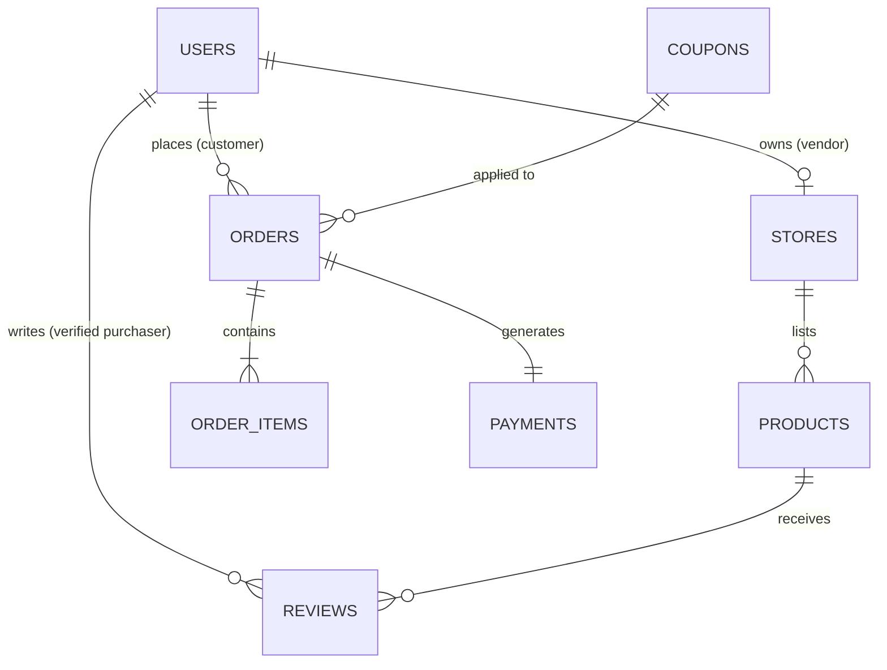

# Database Schema & Data Models

## 1. MongoDB Collections Overview

The marketplace relies on 8 primary MongoDB collections plus a Redis key-value store for transient shopping carts.



---

## 2. Detailed Schemas

### 2.1 Users (`users`)
Stores customer, vendor, and admin accounts.
- `_id`: ObjectId
- `name`: String (required, trimmed)
- `email`: String (required, unique, lowercase, indexed)
- `passwordHash`: String (required, bcrypt hashed)
- `role`: Enum `['customer', 'vendor', 'admin']` (default: `'customer'`)
- `status`: Enum `['active', 'suspended', 'pending']` (default: `'active'`)
- `createdAt`: Timestamp
- `updatedAt`: Timestamp

### 2.2 Stores (`stores`)
Represents vendor stores approved by the admin.
- `_id`: ObjectId
- `ownerId`: ObjectId (ref: `User`, unique, indexed)
- `name`: String (required, unique)
- `slug`: String (required, unique, indexed)
- `description`: String
- `logo`: String (S3 URL)
- `banner`: String (S3 URL)
- `approvalStatus`: Enum `['pending', 'approved', 'rejected']` (default: `'pending'`)
- `paymentAccountId`: String (Razorpay linked account or provider reference)
- `createdAt`: Timestamp
- `updatedAt`: Timestamp

### 2.3 Products (`products`)
Products listed by approved vendors.
- `_id`: ObjectId
- `storeId`: ObjectId (ref: `Store`, indexed)
- `vendorId`: ObjectId (ref: `User`, indexed)
- `title`: String (required, indexed)
- `slug`: String (required, unique)
- `description`: String (required)
- `category`: String (required, indexed)
- `price`: Number (required, min: 0)
- `stock`: Number (required, min: 0)
- `images`: Array of Strings (S3 URLs)
- `status`: Enum `['draft', 'active', 'archived']` (default: `'active'`)
- `averageRating`: Number (default: 0)
- `reviewCount`: Number (default: 0)
- `createdAt`: Timestamp
- `updatedAt`: Timestamp

### 2.4 Orders (`orders`)
Customer purchase orders supporting items from multiple vendors.
- `_id`: ObjectId
- `orderNumber`: String (unique, e.g. `ORD-20261026-XXXX`)
- `customerId`: ObjectId (ref: `User`, indexed)
- `items`: Array of Subdocuments:
  - `productId`: ObjectId (ref: `Product`)
  - `storeId`: ObjectId (ref: `Store`, indexed)
  - `vendorId`: ObjectId (ref: `User`, indexed)
  - `title`: String (snapshot)
  - `price`: Number (snapshot)
  - `quantity`: Number (required, min: 1)
  - `fulfillmentStatus`: Enum `['placed', 'packed', 'shipped', 'delivered', 'cancelled']` (default: `'placed'`)
  - `trackingNumber`: String (optional)
- `shippingAddress`: Object (fullName, address, city, state, postalCode, country, phone)
- `totals`:
  - `subtotal`: Number
  - `discount`: Number
  - `shipping`: Number
  - `tax`: Number
  - `grandTotal`: Number
- `appliedCoupon`: ObjectId (ref: `Coupon`, optional)
- `paymentStatus`: Enum `['pending', 'paid', 'failed', 'refunded']` (default: `'pending'`)
- `overallStatus`: Enum `['placed', 'in_progress', 'completed', 'cancelled']`
- `createdAt`: Timestamp
- `updatedAt`: Timestamp

### 2.5 Payments (`payments`)
Financial audit trail and platform commission calculation.
- `_id`: ObjectId
- `orderId`: ObjectId (ref: `Order`, unique, indexed)
- `provider`: String (e.g. `'razorpay'`)
- `providerOrderId`: String (indexed)
- `providerPaymentId`: String (indexed)
- `amount`: Number (total paid)
- `currency`: String (default: `'INR'`)
- `platformCommissionRate`: Number (e.g., 10%)
- `totalCommission`: Number (₹)
- `vendorTransfers`: Array of Objects:
  - `vendorId`: ObjectId (ref: `User`)
  - `storeId`: ObjectId (ref: `Store`)
  - `grossAmount`: Number
  - `commissionAmount`: Number
  - `netPayout`: Number
  - `transferStatus`: Enum `['pending', 'completed', 'simulated', 'failed']`
  - `providerTransferId`: String
- `status`: Enum `['created', 'authorized', 'captured', 'failed']`
- `webhookEvents`: Array of Objects (audit trail of processed webhook IDs)
- `createdAt`: Timestamp

### 2.6 Reviews (`reviews`)
Verified purchase ratings and feedback.
- `_id`: ObjectId
- `customerId`: ObjectId (ref: `User`, indexed)
- `productId`: ObjectId (ref: `Product`, indexed)
- `orderId`: ObjectId (ref: `Order`)
- `rating`: Number (1 to 5, required)
- `comment`: String
- `status`: Enum `['published', 'hidden', 'flagged']` (default: `'published'`)
- `createdAt`: Timestamp

### 2.7 Coupons (`coupons`)
Promotional codes and discounts.
- `_id`: ObjectId
- `code`: String (required, unique, uppercase)
- `type`: Enum `['percentage', 'fixed']`
- `value`: Number (required)
- `minCartValue`: Number (default: 0)
- `maxDiscount`: Number (optional for percentage)
- `expiry`: Date
- `usageLimit`: Number
- `usageCount`: Number (default: 0)
- `isActive`: Boolean (default: true)

---

## 3. Redis Transient Store (Cart)

- **Key Format**: `cart:user:<userId>`
- **TTL**: 604800 seconds (auto-extended on mutation)
- **Data Structure**: JSON string or Hash representing cart items:
  ```json
  {
    "items": [
      {
        "productId": "653a1b...",
        "quantity": 2
      }
    ],
    "updatedAt": "2026-10-26T14:00:00.000Z"
  }
  ```
- **Rule**: Product prices and inventory are always freshly read and validated against MongoDB on cart retrieval and checkout.

---

## 4. Model Indexes & Logic Guarantees

| Collection | Indexes | Critical Logic Guarantees |
| :--- | :--- | :--- |
| **Users** | `email: 1` (unique) | Passwords hashed with `bcrypt` (10 rounds); `passwordHash` omitted from JSON responses by default. |
| **Stores** | `ownerId: 1` (unique), `slug: 1` (unique), `approvalStatus: 1` | One approved store per vendor account; only approved vendors can publish products. |
| **Products** | `slug: 1` (unique), `{ status: 1, category: 1, price: 1 }`, `{ storeId: 1, status: 1 }` | Compound indexes optimize multi-faceted filtering and catalog queries. |
| **Orders** | `orderNumber: 1` (unique), `customerId: 1`, `items.storeId: 1`, `items.vendorId: 1` | Line items snapshot product title, price, and vendor at purchase time. Individual item fulfillment states derive overall order status. |
| **Payments** | `orderId: 1` (unique), `providerOrderId: 1`, `providerPaymentId: 1` | Immutable commission calculation recorded at checkout. Idempotent webhook event ledger. |
| **Reviews** | `{ customerId: 1, productId: 1 }` (unique), `orderId: 1` | Compound unique index ensures 1 verified review per customer per purchased product. Requires valid order reference. |
| **Coupons** | `code: 1` (unique), `expiry: 1`, `isActive: 1` | Evaluates expiration, usage limits, and minimum cart subtotal. |

